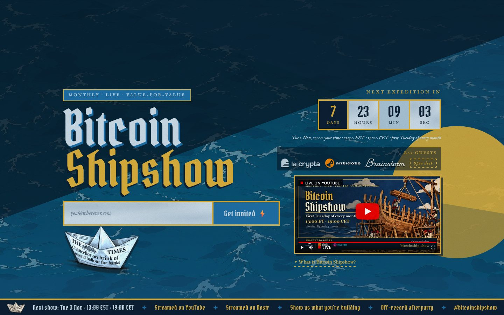

# Bitcoin Shipshow, the website ⛵

**The source of [bitcoinship.show](https://bitcoinship.show), the website of Bitcoin Shipshow.**

Shipshow is a monthly online community call where builders demo what they actually ship on Bitcoin, Lightning and Nostr.

Live demos, not pitches. First Tuesday of every month, 13:00 ET · 19:00 CET.

[🌐 bitcoinship.show](https://bitcoinship.show) · [ℹ️ About & FAQ](https://bitcoinship.show/about/) · [▶️ YouTube](https://www.youtube.com/@BitcoinShipshow) · [𝕏 @bitcoinshipshow](https://x.com/bitcoinshipshow) · [🟣 Nostr](https://njump.me/npub1mtjn0yp705hvgszssf2ddjpzk3zzjzgvu58dwwpkxqud0hde6fxss7cwyw) · [✉️ Say hello](mailto:hello@bitcoinship.show)

 

---

## 👋 Ahoy!

Bitcoin Shipshow is part TV show, part community call. Every month a few builders share their screen and show something that really runs: a wallet, a Lightning tool, a Nostr client, a film, a map, a music app. Early and unknown projects stand next to one project with a fresh release. Working demos only, alpha and beta welcome, no slideware, no price talk.

It is free to watch and free to demo. It is independent and community-run: the hosts pick every slot, and tips and zaps on the stream go to the people building.

**This repository is the code of the website [bitcoinship.show](https://bitcoinship.show)**, nothing else. Plans, decisions and episode files live in a separate private repo. If you landed here by accident: **[open the site](https://bitcoinship.show)** and leave your email to get the invite. 🧡

## 🚦 Where we are

| | |
|---|---|
| 🟢 **Status** | **Live.** The site is running and the show has started. Expedition 01 aired on Tue 6 Oct 2026, its replay is on YouTube. |
| 🗓️ **Next** | Expedition 02, Tue 3 Nov 2026, 13:00 ET · 19:00 CET. The line-up is on the [homepage](https://bitcoinship.show). |
| 🔁 **Rhythm** | First Tuesday of every month, about 90 minutes public and streamed, then about 30 minutes off the record in the room. |

## 🎬 How the show works

1. **Watch.** The stream is public and every expedition is published afterwards as a full episode plus clips on [YouTube](https://www.youtube.com/@BitcoinShipshow). Follow `#bitcoinshipshow`.
2. **Join the room.** Leave your email on [bitcoinship.show](https://bitcoinship.show). The invite with a calendar entry arrives in your inbox. The room link is never posted on the public site.
3. **Demo.** Three to five demos per expedition, plus one slot kept for a project with no partner behind it.

## 🛠️ Want to demo?

Yes please. Early and unknown is exactly what we want. If it runs, even roughly, it is ready.

1. Leave your email on the [front page](https://bitcoinship.show).
2. When the invite arrives, reply and tell us what you are building.
3. Or just turn up to a show and introduce yourself in the room.

Questions first? Write to [hello@bitcoinship.show](mailto:hello@bitcoinship.show). More answers are in the [FAQ](https://bitcoinship.show/about/).

## 🤝 Want to help with the site?

The site is a plain PHP project. Good first contributions:

- 🐛 A bug, a broken link or a layout problem on a phone: [open an issue](https://github.com/Bitcoin-ShipShow/bitcoinshipshow-com/issues).
- ✏️ A typo or a clearer sentence: open a pull request.
- 💡 An idea for the show or the site: open an issue, or write to [hello@bitcoinship.show](mailto:hello@bitcoinship.show).

Production is deployed by script from a separate working copy, not from this repo, so a merged pull request is applied there by a maintainer before it goes live. Never put secrets, signup data or personal emails in an issue or a PR.

Build, run and layout notes are in [DEVELOPMENT.md](DEVELOPMENT.md).

## 📍 Find us

| | |
|---|---|
| 🌐 Website | [bitcoinship.show](https://bitcoinship.show) |
| ▶️ Replays | [youtube.com/@BitcoinShipshow](https://www.youtube.com/@BitcoinShipshow) |
| 𝕏 X | [@bitcoinshipshow](https://x.com/bitcoinshipshow) |
| 🟣 Nostr | [npub1mtjn0y…de6fxss7cwyw](https://njump.me/npub1mtjn0yp705hvgszssf2ddjpzk3zzjzgvu58dwwpkxqud0hde6fxss7cwyw) |
| ⚡ Zaps | `ahoy@bitcoinship.show` (Lightning address) |
| ✉️ Contact | [hello@bitcoinship.show](mailto:hello@bitcoinship.show) |
| 🎨 Brand kit | [bitcoinship.show/assets](https://bitcoinship.show/assets/), logos, colours, type and posters for talking about the show |

## 📜 Licence

This repository has no licence file yet, so the code is not licensed for reuse. Ask first. The brand kit is free to use when you talk about the show.

---

**Show us what you're building.** ⚡ Fair winds. ⛵

